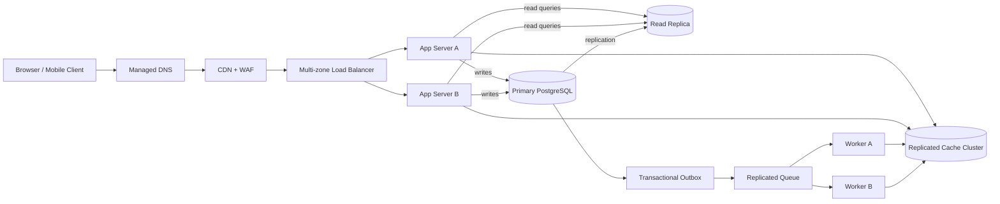

# QuickNotes Architecture

## Requirements

### Functional

- Users can register, sign in, and access only their own notes and tags.
- Users can create, read, update, soft-delete, search, and tag notes.
- Note titles are required and limited to 100 characters; note bodies may be empty.
- Clients can list notes newest-first with cursor pagination and filter by text or tag.
- The service returns useful validation and authorization errors without exposing internal details.

### Non-functional

- Target 99.9% monthly availability for note reads and writes.
- Keep p95 API latency below 300 ms for reads and 500 ms for writes at the stated peak load, excluding client network time.
- Preserve committed notes durably, with automated backups and tested point-in-time recovery.
- Enforce TLS in transit, encryption at rest, per-user authorization, rate limits, and auditability.
- Scale application capacity horizontally and keep the service operable through an instance or availability-zone failure.
- Paginate large collections and apply per-user resource limits to bound query and storage costs.

## Load estimate: 1 million registered users

Planning assumptions: 20% of registered users are active each day (200,000 DAU); each active user makes 20 note-list/detail reads and creates 2 notes per day; peak traffic is 10 times the daily average; an average stored note consumes about 2 KiB before replica copies and backups.

| Measure | Estimate | Calculation |
| --- | --- | --- |
| Reads | 4,000,000/day; about 46 reads/second average and 460/second peak | 200,000 DAU x 20 reads/day; divide by 86,400 and apply a 10x peak factor |
| Writes | 400,000/day; about 4.6 writes/second average and 46/second peak | 200,000 DAU x 2 notes/day; divide by 86,400 and apply a 10x peak factor |
| New note storage | About 146 million notes/year; approximately 300 GB/year raw and 600 GB/year including indexes and row overhead | 400,000 writes/day x 365 x 2 KiB/note, then budget roughly 2x for database overhead |

These are initial capacity estimates, not measured production traffic. Replicas, backups, logs, and temporary migration space add infrastructure storage beyond the logical primary-data estimate. Revisit the assumptions using production telemetry and load tests.

## Architecture

| Component | Problem it solves |
| --- | --- |
| Client | Provides the user interface and sends authenticated API requests over HTTPS. |
| Managed DNS | Resolves the service hostname and can route clients away from an unhealthy region. |
| CDN + WAF | Serves static assets near users and filters common abusive or malicious traffic before it reaches the API. |
| Multi-zone load balancer | Distributes API requests across healthy app instances and performs health checks. |
| App servers A and B | Validate tokens and inputs, enforce ownership, execute business logic, and scale horizontally. |
| Replicated cache cluster | Reduces repeated reads for hot data and absorbs bursts; it is an optimization, not the source of truth. |
| Primary PostgreSQL | Provides durable transactional writes and enforces relational constraints. |
| Read replica | Handles eligible read traffic so listing notes does not compete as heavily with writes. |
| Transactional outbox | Stores publish work in the same transaction as a note write so committed changes are not lost before enqueueing. |
| Replicated queue | Buffers asynchronous work, absorbs traffic spikes, and supports retry after temporary worker failures. |
| Workers A and B | Process outbox events for cache invalidation, indexing, and notifications without delaying the API response. |

## Request flows

### `GET /v1/notes`

1. The client resolves the API hostname through managed DNS and sends an HTTPS request through the CDN/WAF.
2. The load balancer routes to a healthy app server in an available zone.
3. The app validates the access token, checks the user's authorization, and validates pagination and filter parameters.
4. The app checks the cache for a matching user-scoped page; cache keys include the user and query parameters to prevent cross-user leakage.
5. On a cache miss, the app queries the read replica using the user's ID, active-note predicate, stable cursor ordering, and page limit; a short read-after-write window can route to the primary to avoid replica lag after a create or update.
6. The app caches the result with a short TTL and returns the JSON page and next cursor. Cache failures fall back to the database.

### `POST /v1/notes`

1. The client sends an authenticated HTTPS request through the CDN/WAF and load balancer to a healthy app server.
2. The app validates the token, enforces the title and body limits, and verifies any tag IDs belong to the signed-in user.
3. In one database transaction, the app inserts the note and its tag links and records an outbox event; the database assigns the note ID and timestamps.
4. After commit, the app returns `201 Created` with the created note. It never acknowledges success before the primary transaction commits.
5. An outbox publisher puts the event on the replicated queue; a worker invalidates relevant cache entries and performs slower indexing or notification work.
6. Failed asynchronous attempts are retried with bounded backoff and sent to a dead-letter queue after the retry limit for inspection.

## Trade-offs and failure handling

- **Read replica versus read-after-write consistency:** replicas increase read capacity but can lag. Most list reads use the replica; after a successful mutation, the API returns the committed representation and routes that user's short read-after-write window to the primary. This adds routing complexity but avoids stale immediate reads.
- **Cache speed versus invalidation complexity:** caching hot note pages reduces database load, but stale or incorrectly scoped data is a correctness and privacy risk. Cache keys include user identity and filters, workers invalidate after commit, TTLs bound stale data, and a cache outage falls back to the database.
- **Asynchronous side effects versus operational complexity:** queue-backed indexing and notifications keep write latency low and absorb bursts, but introduce eventual consistency and retry handling. The transactional outbox prevents a committed note from losing its event; idempotent workers and a dead-letter queue make retries safe to operate.
- **Relational integrity versus horizontal write scaling:** a single PostgreSQL primary makes ownership, tags, and transactions straightforward, but is the main write bottleneck. Start with vertical capacity, connection pooling, and a multi-zone failover standby; partition or shard only when measured write volume requires it, because sharding complicates cross-note queries and migrations.

No component should be a single point of failure: serve app instances across at least two availability zones behind a health-checking load balancer; use redundant managed DNS/CDN edges; run the cache and queue as replicated clusters; keep multiple worker consumers; and use a managed database with automated primary failover, a separate read replica, point-in-time backups, and regularly tested restore procedures. Monitor failover and recovery objectives, and alert on replica lag, queue age, error rate, and saturation. A regional outage still requires a documented recovery plan and tested backups or cross-region replicas; multi-zone redundancy alone does not prevent it.